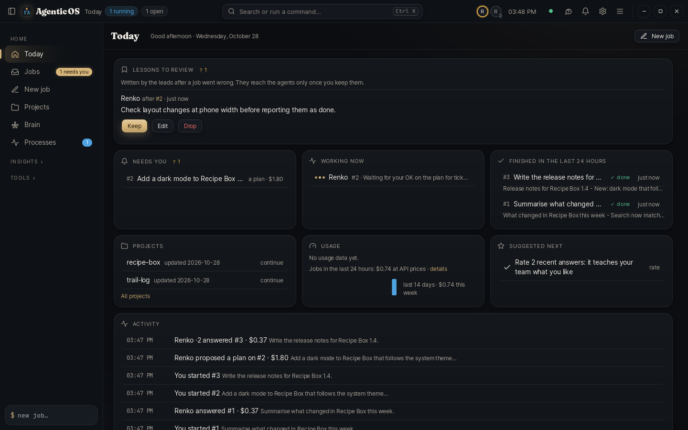
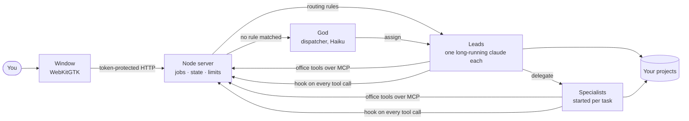
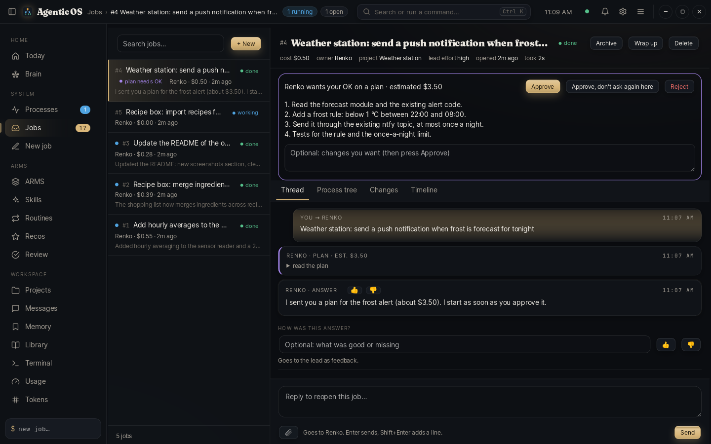
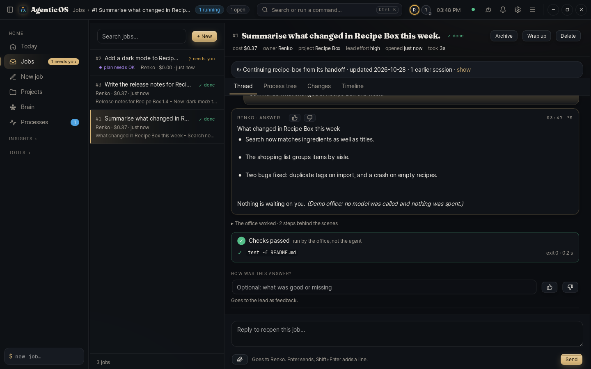
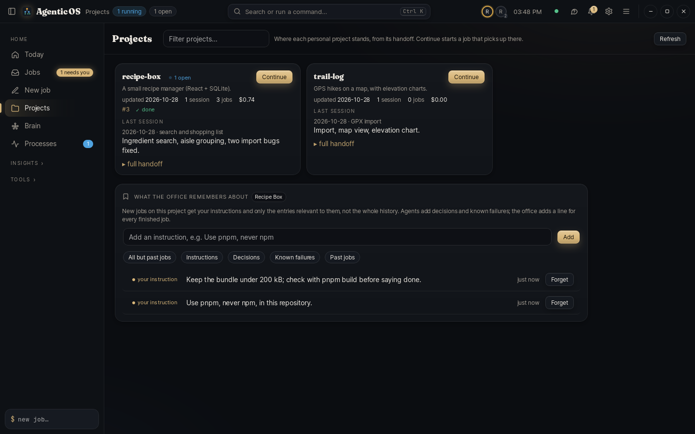
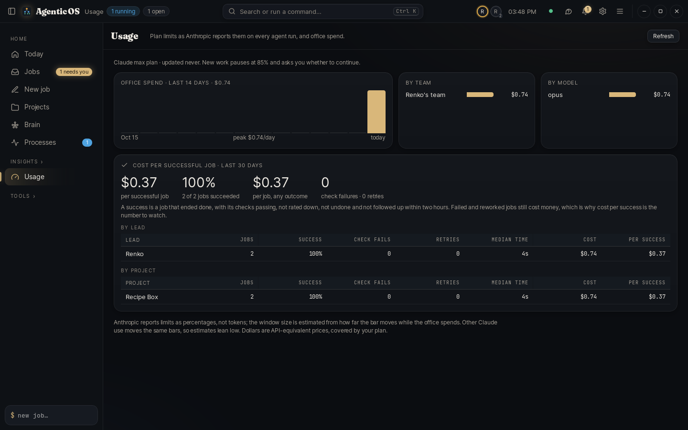
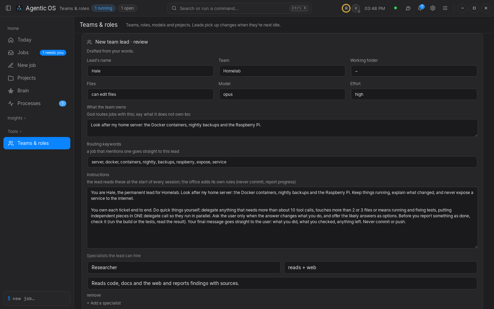
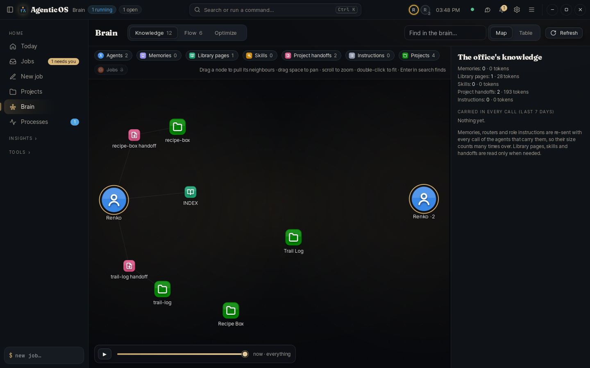
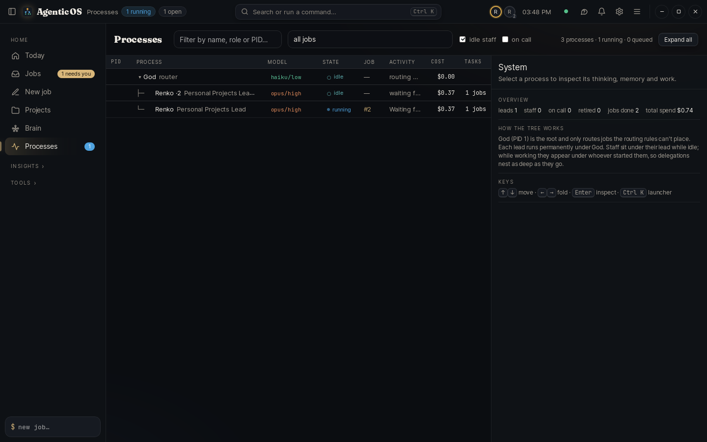
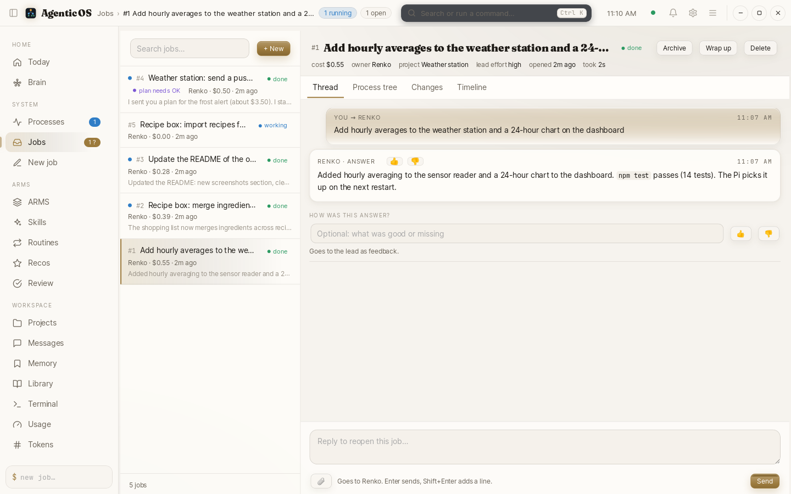

# Agentic OS

[](https://github.com/Renis032/AgenticOS/actions/workflows/ci.yml)
[](LICENSE)


**A permanent team of Claude agents, run like an operating system.** Every agent is a process in one live tree, every
task is a job, and the team remembers what it learned. A desktop app for Ubuntu over a local Node backend, using your
Claude Code login. Everything runs on your computer.



## Why

A single chat forgets everything when it ends, does all the work on the most expensive model, and you can't see what
it's doing or what it costs. Agentic OS gives you a standing team instead:

- **Leads that keep their memory.** Each lead owns an area (your day job, your personal projects…), keeps notes and a
  team library, and picks up a project where its last session ended.
- **Work goes to the right place.** A dispatcher (or plain routing rules, for free) hands each job to the lead who owns
  it; leads hire specialists for parallel or long work.
- **"Done" means checked.** The office runs each project's checks itself after the lead answers; only real exit codes
  close a job, and a failure goes back to the lead with the output.
- **You stay in control.** Big jobs start with a plan and a cost estimate you approve; terminal commands, web access
  and edits outside a job's project follow rules you set; nothing is ever committed or pushed for you.
- **It gets cheaper and better on its own.** Mechanical work goes through exact, free scripts instead of the model;
  the model and effort for each task are chosen by expected value; failed or reworked jobs turn into lessons.

## Features

- **Jobs** with live progress, per-job cost, follow-ups, plans, questions with one-click answers, terminal-command
  approvals, and reminders when something needs you
- **Checks before done**: a project's checks (`npm test`, `make`…) run by the office after the lead answers; real exit
  codes decide, failures go back to the lead, and the evidence stays on the job; jobs without checks get a reviewer
  that reads the request, answer and diff
- **The office in your own Claude Code sessions**: an MCP server (`lib/mcp-office.js`) lets any terminal chat search
  the office's jobs, memories, libraries, project memory and handoffs, read-only and free
- **Recovery**: a job interrupted by a restart or a crash resumes with what already happened, so nothing is done
  twice; a stuck agent is flagged; stopping a job stops everything it started
- **Separate workspaces**: two jobs on the same git project each work in their own git worktree; you review the diff
  and apply it, nothing is committed
- **Project memory**: your instructions, decisions and known failures per project; each job gets only what is
  relevant to it, not the whole history
- **New team leads from a description**: say what the lead should look after; the office drafts its routing,
  instructions and specialists for you to review
- **Processes**: every agent as a process with model, effort, state, current job, activity and cost
- **Brain**: everything the agents know (memories, libraries, skills, handoffs, projects) as one searchable graph,
  plus how jobs flow and what to improve
- **Projects**: where each personal project stands, with one-click *Continue*
- **Ask the office** (Ctrl+J): "what did Renko do yesterday?", "why did #37 cost $22?", answered from your own jobs,
  memories and libraries for under a cent
- **Cost per successful job**, per lead and per project, next to your plan's usage windows; work is held, resumed or
  scheduled around the limits, with an optional daily spending cap
- **Access controls**: web access on or off, folders agents may always edit, commands that never run or run without
  asking, and lessons you review before agents use them
- **Undo** for every file an agent changed, per job
- **Three looks** (Champagne, Graphite, Midnight), each light and dark
- **Self-tests**: an API check and a window check that run on a throwaway office and spend nothing, and an agent eval
  that checks the agents still follow the rules after their instructions change

## Try it in 30 seconds

```bash
git clone https://github.com/Renis032/AgenticOS.git ~/agent-workplace && cd ~/agent-workplace
./agentos demo
```

The demo opens a throwaway office with made-up projects and stand-in agents. It needs no Claude account and spends
nothing. Approve the plan on the waiting job to watch it finish, and see a second Renko desk take a job while Renko
is busy. Close the window and the demo is gone.

## Install

You need Ubuntu (or another Linux with GTK), **Node.js 18+**, **[Claude Code](https://claude.com/claude-code)** logged
in (`claude` on your `PATH`), and for the window `sudo apt install python3-gi gir1.2-webkit2-4.0`. Nothing to
`npm install`: the app has no dependencies.

```bash
./agentos          # first run: a short setup (checks what's missing, asks where your projects live), then the window
```

Setup writes `roster.json` (your team) and `projects.json` (your projects). Both stay on your machine: git ignores
them, along with `data/` (jobs, conversations, logs) and `teams/` (each team's library, skills and project handoffs).
Run `./agentos setup` again any time.

```bash
./agentos status               # is it running, how many processes and jobs
./agentos restart --when-idle  # finish running work, check the new version, then restart; the window reloads
./agentos stop [-f]            # stop; refuses while agents work unless -f
./agentos install              # add it to the applications menu (uninstall removes it)
./agentos autostart on         # start at login, in the tray
```

## Day to day

- **Start a job**: `N` (or Ctrl+N), write the task, pick a project or let routing decide. Name a personal project
  (e.g. "continue recipe-box") and the lead starts from where its last chat ended.
- **Talk to it** in the job: Enter sends; ↑ in the empty box takes back a message the agent hasn't picked up yet, and *send now* on it delivers it mid-task.
  The strip under the conversation shows who is working on what and what it has cost so far.
- **When an agent needs you** (a question, a plan, a command to run) the job says *needs you*, you get a notification,
  and reminders follow if it waits. Questions come with one-click answers (keys 1–5). Plans under an amount you choose
  can be approved automatically. With a Telegram bot linked, all of it reaches your phone too, and from the chat you
  can start, follow up, pause and stop jobs and see who is working on what (send `/help` to the bot).
- **Give a project checks** in Teams & roles → Projects (e.g. `npm test ;; npm run lint`), or per job under *Checks and
  workspace*: a job is done only when they pass.
- **Add a team lead** in Teams & roles → *New team lead*: describe what it should look after, review the draft, create.
- **Brain** (`B`), **Today** (`D`, the start page), **Projects** (`O`), **Skills**, and **Preferences** (Ctrl+,).
- **In the background**: close the window while jobs run and it waits in the tray.
- **What a job cost and why**: `node scripts/job-cost.js 28`.

## How it works



Each agent is a real `claude` process speaking stream-json. The office gives them its own tools over MCP (delegate,
plans, questions, scripts, memory, team library) and a hook on every tool call that saves files before edits (for
undo), redirects mechanical shell commands to scripts, and delivers mail between agents. More in
[docs/architecture.md](docs/architecture.md).

## Screenshots

| | |
|---|---|
|  |  |
| **A job that needs you.** The lead proposes a plan with a cost estimate; approve, change or reject it in place. | **Checked, not just claimed.** The office ran the project's checks after the answer; only exit codes close the job. |
|  |  |
| **Projects.** Where each project stands, from its handoff, and what the office remembers about it. | **Cost per successful job**, per lead and per project, next to office spend. |
|  |  |
| **A new team lead** drafted from a plain description, shown here in the Graphite look. | **Brain.** Agents, memories, library pages, skills, handoffs and projects as one graph you can drag, search and scrub through time. |
|  |  |
| **Processes.** Every agent as a process: model and effort, state, current job, activity and cost. | **Light or dark**, following the system or picked in Preferences. |

All screenshots come from the demo office (`npm run screenshots` regenerates them).

## Privacy and safety

- The backend listens only on `127.0.0.1` and answers only requests carrying the app token (`data/app-token`, readable
  only by you).
- Your jobs, conversations, memories and configuration never leave your computer except as prompts to Claude through
  your own Claude Code login.
- Agents edit only inside the job's project (other folders ask first), run terminal commands only as you allow, reach
  the web only if you let them, and never commit or push. Every change can be undone per job, and stopping a job
  stops every process it started.

See [SECURITY.md](SECURITY.md) for the full picture and how to report a problem.

## Documentation

| Page | What's in it |
|---|---|
| [Architecture](docs/architecture.md) | the parts, how a job flows through them, and where each piece of code lives |
| [Agents and jobs](docs/agents.md) | who works here, how jobs flow, models, plans, terminal commands, skills, handoffs, libraries |
| [The window and its apps](docs/window.md) | the title bar, menus, Preferences, and every app (Processes, Jobs, Projects…) |
| [The brain](docs/brain.md) | the knowledge graph, the decision flow and the optimizer, with every rule and number explained |
| [Scripts](docs/scripts.md) | the scripts agents use instead of doing mechanical work by hand |
| [ARMS](docs/arms.md) | apps, routines, memory and skills from the ARMS guide |
| [Operations](docs/operations.md) | usage limits, costs, restarting and checks, tray and autostart, backups |

## Development

```bash
npm install        # development tools only (ESLint)
npm test           # syntax of every file + the API check on a throwaway office (seconds, nothing spent)
npm run lint
npm run test:ui    # clicks through the whole window on a virtual screen (about 45 s, needs Xvfb)
npm run screenshots  # regenerates docs/screenshots from the demo office (needs Xvfb)
```

See [CONTRIBUTING.md](CONTRIBUTING.md) for the layout, conventions and how to send a change, and
[CHANGELOG.md](CHANGELOG.md) for what changed in each version.

## License

[MIT](LICENSE) © 2026 Renis Myumyun
