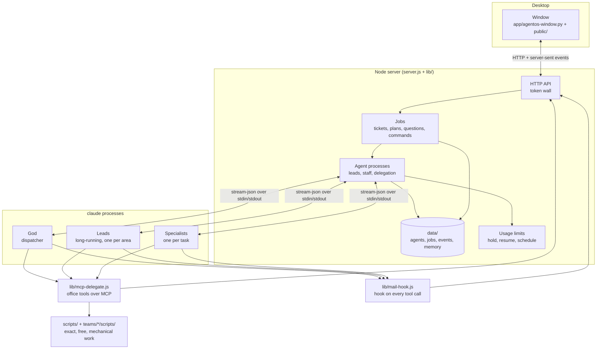
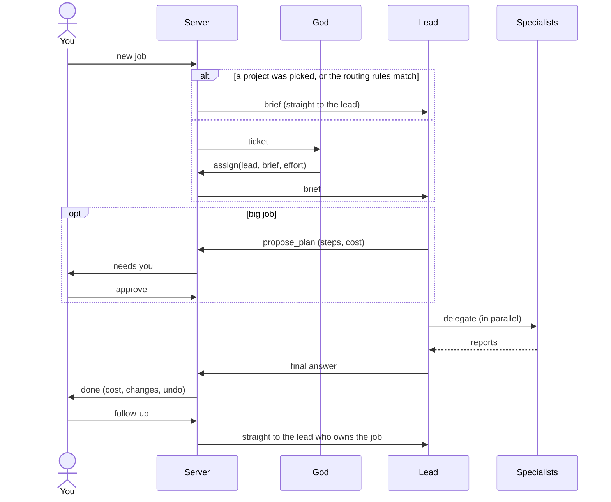

# Architecture

How Agentic OS is put together: the parts, how a job flows through them, and where each piece of code lives.

[← Back to the README](../README.md)

## The parts

- **The window** is a GTK + WebKitGTK shell (`app/agentos-window.py`) around the page in `public/`. It talks to the
  server over HTTP and receives live updates as server-sent events.
- **The server** owns all state. It starts every agent as a `claude` process, feeds it messages as stream-json on
  stdin and reads its events from stdout. State is saved to `data/` and survives restarts; agents resume their
  sessions.
- **Agents** never talk to each other directly. They use the office tools (`lib/mcp-delegate.js`), an MCP server
  started inside each agent's process, which calls the server's HTTP API: delegate, ask the user, propose a plan,
  run a script or a terminal command, save memory, write to the team library, send mail.
- **The hook** (`lib/mail-hook.js`) runs on every agent tool call. Before an edit it lets the server save the file
  (for undo) and enforce the job's edit scope. Before a shell command a script covers, it blocks the command and names
  the script. After any call it delivers unread mail from colleagues.

## How a job flows

1. **Routing** (`scripts/route.js`): a picked project, a path or keywords that clearly belong to one lead send the job
   straight there. God, on Haiku with a fresh session per job, is asked only when nothing matches or two leads match.
2. **Effort**: the user's choice, else the project's `leadEffort`, else God's pick; a short question gets medium
   (`lib/quick-effort.js`).
3. **The lead** works the job, keeping its own turns short and hiring specialists for long or parallel work. The model
   and effort for each specialist come from an expected-value model (`scripts/choose-model.js`).
4. **Gates**: big delegations need an approved plan; terminal commands follow the command mode; edits outside the
   job's project need approval.
5. **The answer** goes straight to you. Follow-ups go to the lead who owns the job, not back through God.
6. **Learning**: a failed, reworked (follow-up within two hours), 👎-rated or undone job asks each lead on it for a
   one-line lesson; agents keep memories and team libraries; repeated mechanical steps become script ideas.

## Where the code lives

| Path | Responsibility |
|---|---|
| `server.js` | startup, shared state, wiring the modules together |
| `lib/` | the server's parts, one `install(ctx)` per module (table below) |
| `lib/mcp-delegate.js` | office tools every agent gets over MCP |
| `lib/mail-hook.js` | hook on every agent tool call |
| `lib/stop.sh` | `./agentos stop`: stops this office's server, refusing while agents work unless `-f` |
| `public/os.html`, `public/ui/` | the window's page: styles in `os.css`, code in `os/*.js` (classic scripts sharing one scope, loaded in order) |
| `app/agentos-window.py` | the native window, tray and notifications |
| `scripts/` | office scripts agents call (`manifest.json`), plus development commands: `setup`, `demo`, `check-syntax`, `api-check`, `ui-check`, `agent-eval` |
| `teams/<team>/` | per team, ignored by git: library pages, project handoffs, skills, and team-only scripts |
| `data/` | runtime state, ignored by git: agents, jobs, events, memory, usage, backups, the app token |
| `roster.json`, `projects.json` | your team and projects, ignored by git; created by `./agentos setup` from the `.example` files |

### Server modules

Each module exports `install(ctx)`: `server.js` passes in what it uses (late-bound where the other side is defined
later) and gets its functions back. No module is over about 650 lines.

| Group | Module | Responsibility |
|---|---|---|
| Core | `state.js` | the office's state on disk: agents, jobs, team state, event logs; saved atomically with a backup copy |
|  | `access.js` | the token wall: only the office's own window gets an answer |
|  | `prompts.js` | what each agent is told and how its `claude` process is started |
|  | `residents.js` | the always-alive leads: their inbox, one message per turn, fresh sessions, restarts |
|  | `staff.js` | specialists: hiring or reusing a teammate, model choice, the run queue, delegation batches, God's `assign` |
|  | `agent-stream.js` | reading each agent's output: events, live spend, exact costs, budgets |
|  | `tickets.js` | jobs: creating and routing them, the schedule, questions, pause, stop, follow-ups, rating, search |
|  | `quick-effort.js` | a lower effort for quick questions |
|  | `suggest-answers.js` | one-click answers suggested from a question's wording |
| HTTP routes | `routes-tickets.js` | jobs |
|  | `routes-agents.js` | agents and the office tools they call |
|  | `routes-office.js` | the window, settings, teams, limits, health |
| Agent tools | `mcp-delegate.js` | the MCP server inside every agent: delegate, plans, questions, scripts, memory, mail |
|  | `mail-hook.js` | the hook on every tool call: save before edit, edit scope, script redirects, mail |
|  | `office-scripts.js` | running office and team scripts for agents |
|  | `commands.js` | terminal commands and their approval |
|  | `edit-scope.js` | where an agent may edit on a job |
|  | `changes.js` | saved copies, diffs and undo |
|  | `shared-files.js` | heads-ups when two agents edit the same file |
|  | `mail.js` | agents talking to each other |
|  | `team-chat.js` | team rooms |
|  | `telegram.js` | plans, questions and commands on your phone through a Telegram bot, with buttons |
| Working well | `plans.js` | plans for big jobs and automatic approval |
|  | `limits.js` | the plan's usage windows: hold, resume, schedule |
|  | `fresh-sessions.js` | fresh sessions when a lead's conversation grows long |
|  | `lessons.js` | lessons from jobs that went wrong, reviewed by the user before agents use them |
|  | `on-call.js` | who stays on a team |
|  | `skills.js` | skills agents propose |
|  | `libraries.js` | team libraries |
|  | `projects.js` | project handoffs and the Projects board |
|  | `secrets.js` | refusing credentials in anything agents save |
|  | `work-area.js` | the day-job area, configured only locally |
| Insight and upkeep | `brain.js` | the knowledge graph, decision flow and optimizer |
|  | `ask-office.js` | Ask the office: facts gathered without a model, worded by Haiku |
|  | `timeline.js` | job timelines and spend |
|  | `health.js` | the Health report |
|  | `evals.js` | the agent eval over time |
|  | `selftest.js` | the office self-test |
|  | `weekly-review.js` | weekly team reports |
|  | `upkeep.js` | reminders, restart when idle, office settings |
|  | `backups.js` | backups and restore |
|  | `teams-config.js` | teams and roles from Settings |
|  | `arms.js` | ARMS: apps, routines, memory and skills |

## Design rules

- **No runtime dependencies.** Node's standard library only, so `git clone` and `./agentos` is the whole install.
- **Anything deterministic is a script, never model work.** Scripts are exact, instant and free; agents call them
  through the `script` tool, and the hook steers shell commands toward them.
- **The expensive context stays small.** Leads' conversations last the whole job and are re-read on every call, so
  long reading and fix loops go to specialists who start fresh.
- **The user decides.** Plans, commands, edits outside scope and anything published are the user's call; agents never
  commit or push.
- **Checks spend nothing.** The API and window checks run a throwaway copy of the office with a stand-in for `claude`.
